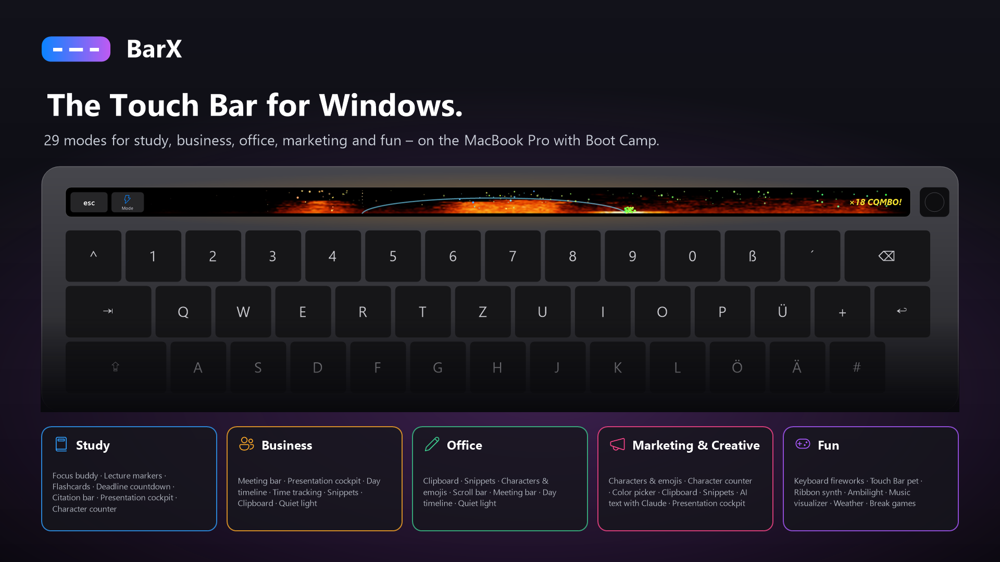
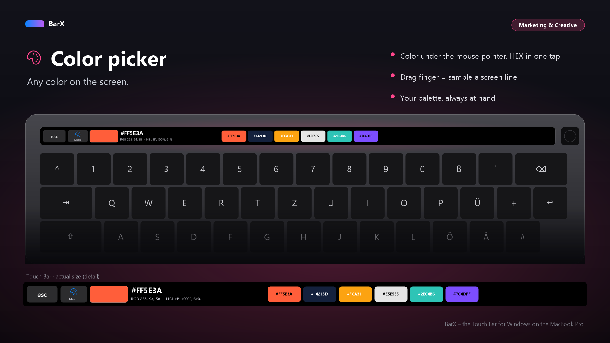
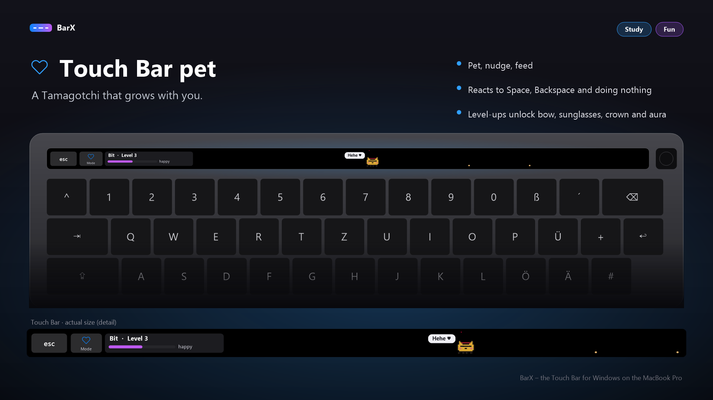
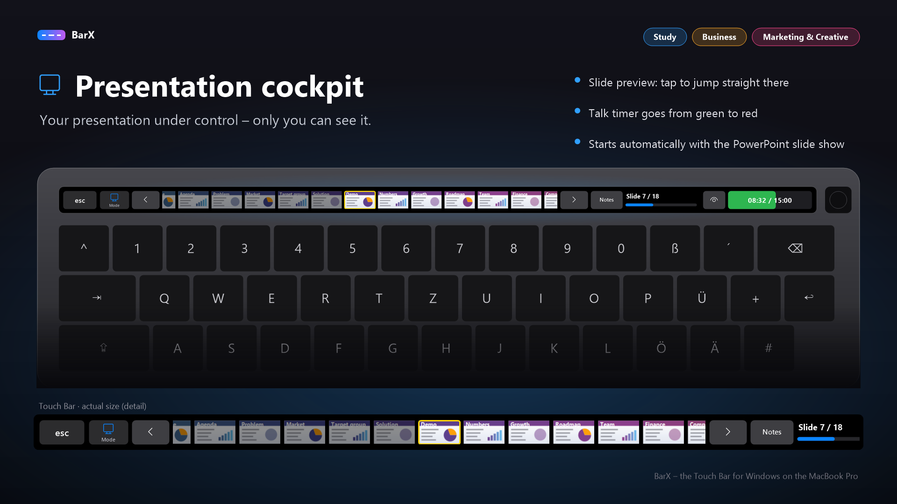
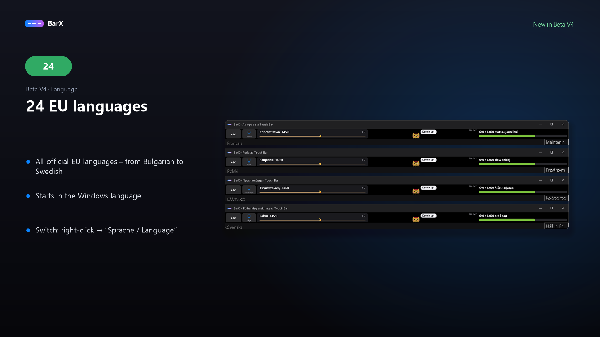
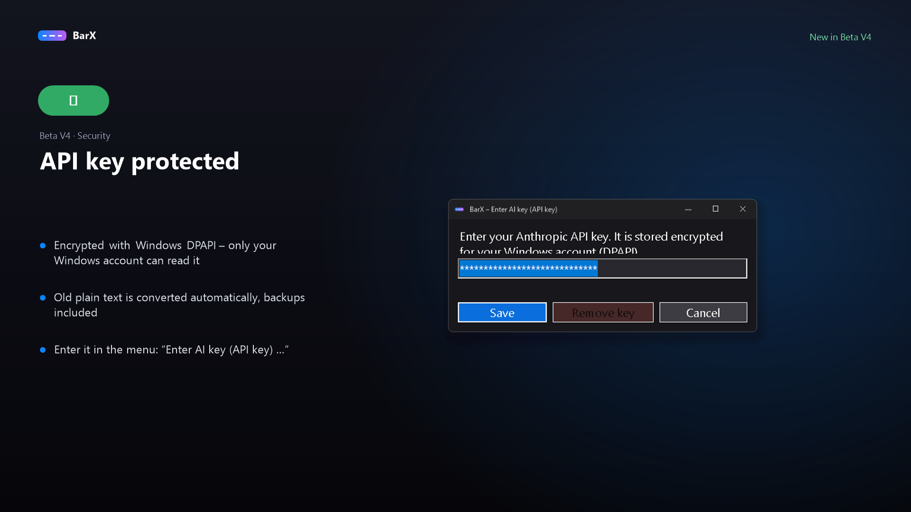
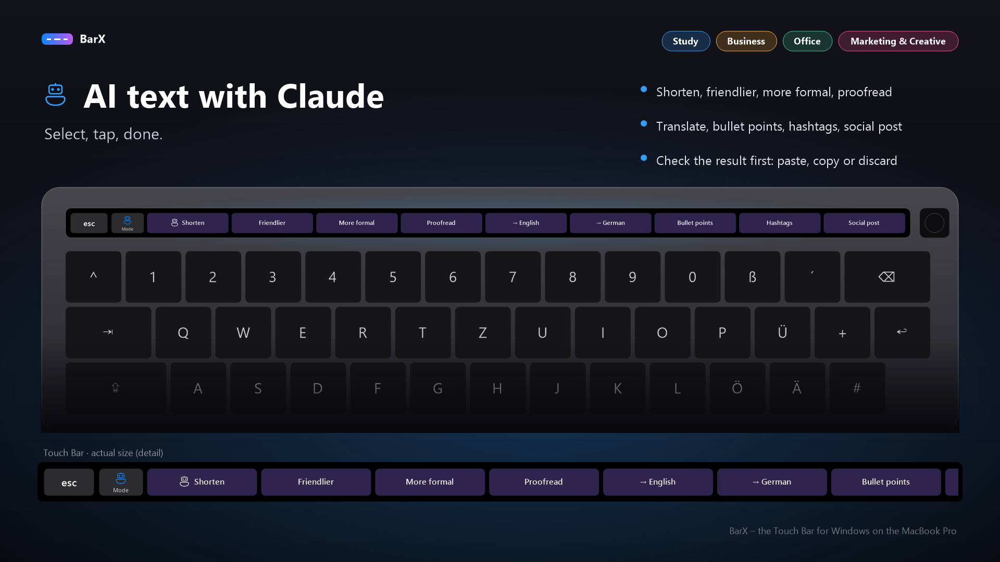

# BarX — Beta V4
**Garage Lab AI · Touch Bar for Windows / Boot Camp · Version 0.9.4**

[Deutsch](README_DE.md) · **English** · [Download Beta V4](https://github.com/Dirtyx686/BarX/releases/tag/v0.9.4-beta)

BarX turns the Touch Bar of an Intel MacBook Pro running Windows into a configurable display with touch input: **29 modes across six profiles** for study, business, office, creative work and fun. The interface supports all 24 official EU languages; the guides and previews are available in German and English.

## Beta / disclaimer

**BETA SOFTWARE. Use at your own risk. Provided without warranty. Garage Lab AI accepts no liability for damage resulting from installation or use.**

On T2 MacBooks the bundled driver requires Windows test-signing mode and Secure Boot disabled. Installation changes driver assignments and boot settings. Some anti-cheat games may not run in test-signing mode. When BarX is not running, the Touch Bar can remain black, including its Escape key. Read the guide before installing.

## Features

- Color picker: live color under the mouse pointer, HEX/RGB/HSL display and tap to copy HEX.
- Presentation controls and speaker notes; meeting controls and microphone level.
- Clipboard history, text snippets, symbols, character counter and scrolling.
- Focus timer, flashcards, deadlines, day timeline and project time tracking.
- Fireworks, virtual pet, ribbon synth, ambilight and music visualizer.
- Weather, market ticker, soundboard and small games.
- Optional Claude text actions with your own Anthropic API key. Selected text is sent to Anthropic; results wait for an explicit insert/copy action. API usage may incur charges. The key is stored encrypted with Windows DPAPI.

## Set up AI Text (Claude)

The **AI Text** mode is available in the **Marketing & Creative**, **Study**, **Business**, **Office** and **All** profiles. It requires your own Anthropic API key; API usage may incur charges.

1. Create an API key in the [Claude Console](https://console.anthropic.com/).
2. Right-click the BarX tray icon → **Enter AI key (API key) …**, enter the key and choose **Save**. BarX encrypts it with Windows DPAPI for the current Windows account on this PC.
3. Select text in an application, open **AI Text** and tap an action such as Shorten, Correct or Translate.
4. Review the result and choose **Paste**, **Copy** or **Discard**. If you switched windows, check the destination before pasting.

**Privacy:** Selected text is sent to Anthropic for processing. The key is stored encrypted as `dpapi:…` in `%AppData%\BarX\settings.json`. Existing plaintext keys are migrated at startup and removed from settings backups and older settings copies. Do not share settings or backups. After moving to another PC or Windows account, enter the key again. Without a key, the other 28 modes remain available. An AI action opens the key dialog; cancelling sends no request to Anthropic.

## New in Beta V4

- All 24 official EU languages; the interface follows Windows and can be changed from the language menu. New translations have not yet been reviewed by native speakers; some uncommon text falls back to English.
- Anthropic API keys are encrypted with Windows DPAPI. A dedicated input dialog replaces editing the key by hand; existing plaintext keys and settings backups are migrated.
- Updated AI preview wording: review results before choosing Paste, Copy or Discard.

## Preview

These images are **generated demo mockups with sample data**, not photographs of a hardware test.

## Tested hardware and current status

Earlier developer testing reported BarX running on **MacBookPro15,1**, with a live test already running for approximately **two hours** when Beta V3 was prepared. This is a developer-reported smoke test, not comprehensive validation of every feature.

Beta V4 was rebuilt on Windows; embedded driver hashes, all 22 additional language packs (386 entries each), and a DPAPI encryption/decryption self-test passed. Hardware installation and sleep/wake behavior were not retested for this update.

T1 (2016/2017) support and its WinUSB-first setup path remain **untested**. Do not interpret device detection as verified compatibility. The notification ticker is experimental.

## Install

1. Download [BarX-Beta-V4-Setup.exe](https://github.com/Dirtyx686/BarX/releases/download/v0.9.4-beta/BarX-Beta-V4-Setup.exe).
2. Start it and choose **Set up everything**; approve the administrator prompt when required.
3. Follow the setup checklist and restart when prompted. For T2 devices, follow the guide for Secure Boot and test-signing requirements.
4. Choose a profile. Right-click the tray icon for preview, settings, language and driver options.

Keep an alternative way to enter Escape available while testing. Long-press Escape to access function keys. See the guide for returning to the original driver.

[English guide](GUIDE_EN.md) · [German guide](ANLEITUNG.md) · [Roadmap](ROADMAP.md)

## V4 improvements

- Interface in all 24 official EU languages, following Windows or selectable from the language menu.
- Anthropic API keys encrypted with Windows DPAPI, with a dedicated input dialog and migration of existing plaintext keys and backups.
- Updated AI previews showing the explicit Paste, Copy and Discard actions.
- Setup checks installation errors and offers a retry.
- Settings use a backup and atomic replacement; save failures are shown in the UI.
- Standby events run through the main task queue; time tracking does not depend on rendering speed.
- German and English guides and demo previews.

## Distribution and credits

This repository provides the compiled BarX beta, German and English guides and demo previews. The BarX application source code is not included. No separate open-source license is granted for BarX.

The installer bundles the **DFRDisplayKm Touch Bar driver by Bingxing Wang (imbushuo)**, using the Naozumi520 distribution. See [third-party notices](THIRD_PARTY_NOTICES.md) and the [driver MIT license](third-party/DFRDisplayKm-LICENSE.txt). That license applies to the driver only.

## Feedback

Please report your Mac model identifier, Windows version, BarX version, reproduction steps and expected/actual behavior in [Issues](https://github.com/Dirtyx686/BarX/issues). Remove API keys and private clipboard contents from logs and screenshots.
