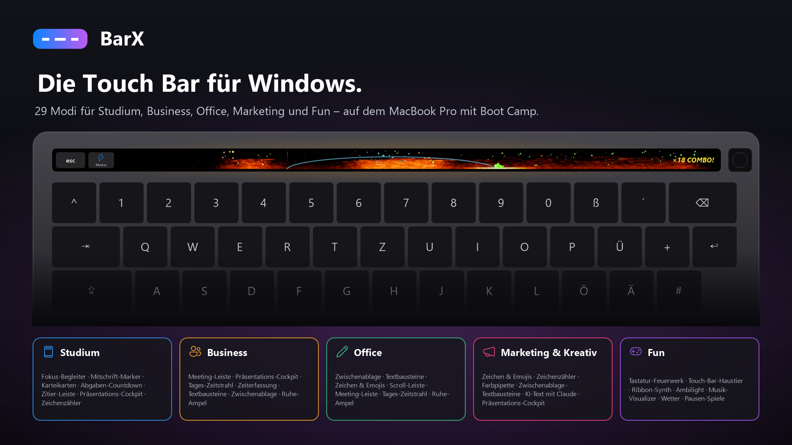
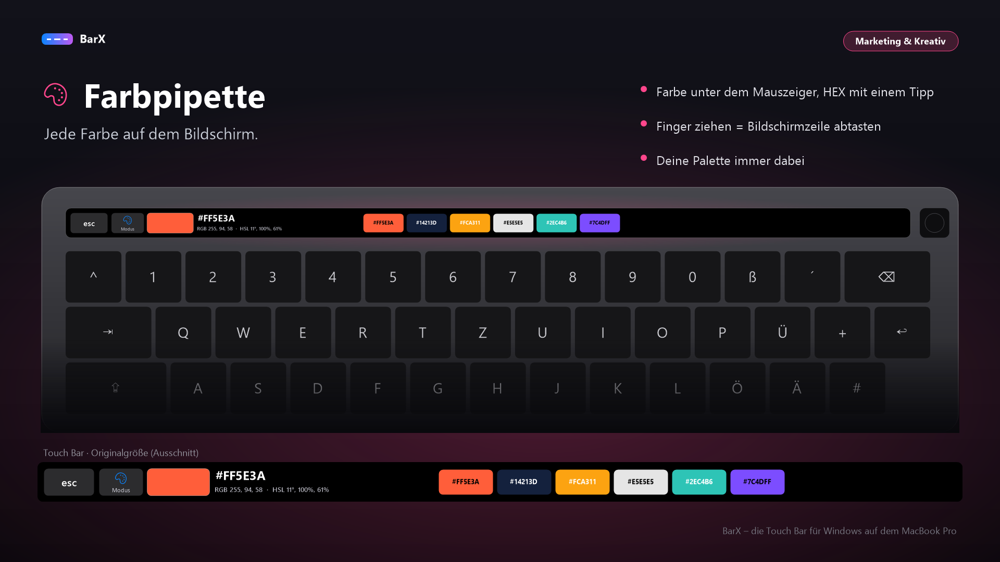
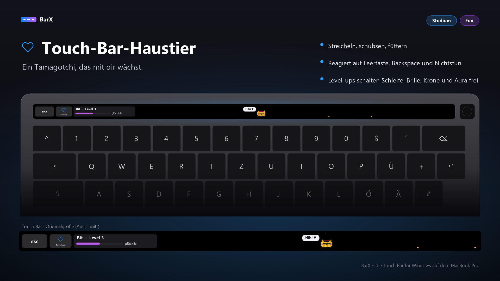
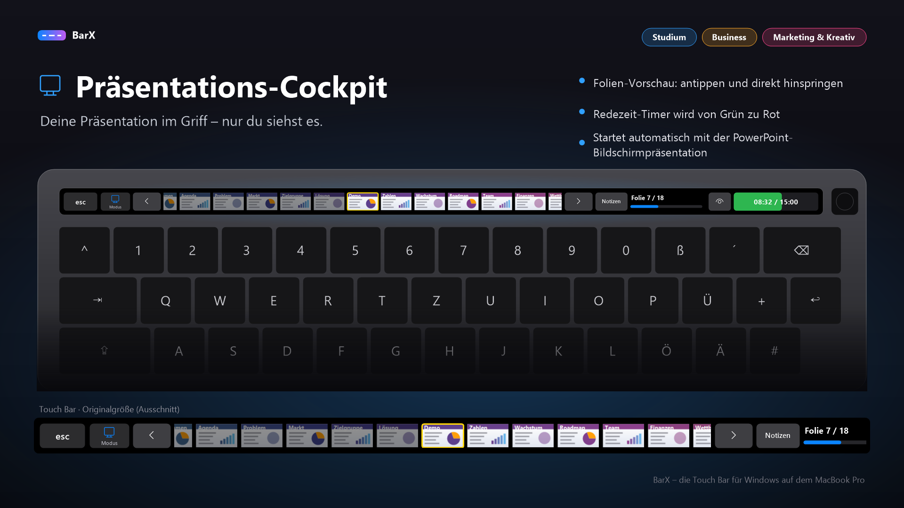

# BarX — Beta V3
**Garage Lab AI · Touch Bar unter Windows / Boot Camp · Version 0.9.3**

**Deutsch** · [English](README.md) · [Beta V3 herunterladen](https://github.com/Dirtyx686/BarX/releases/tag/v0.9.3-beta)



BarX macht die Touch Bar eines Intel-MacBook Pro unter Windows zum konfigurierbaren Bildschirm mit Touch: **29 Modi in sechs Profilen** für Studium, Business, Office, kreative Arbeit und Fun. Die Oberfläche unterstützt Deutsch und Englisch.

## Beta / Haftungsausschluss

**BETA-SOFTWARE. Nutzung auf eigene Gefahr. Keine Gewährleistung. Garage Lab AI übernimmt keine Haftung für Schäden durch Installation oder Nutzung.**

Auf T2-MacBooks benötigt der mitgelieferte Treiber den Windows-Testmodus und deaktiviertes Secure Boot. Die Installation verändert Treiberzuweisungen und Starteinstellungen. Manche Spiele mit Anti-Cheat starten im Testmodus nicht. Läuft BarX nicht, kann die Touch Bar einschließlich Escape schwarz bleiben. Bitte vor der Installation die Anleitung lesen.

## Funktionen

- Farbpipette: Farbe unter dem Mauszeiger, HEX/RGB/HSL und HEX per Tipp kopieren.
- Präsentationssteuerung und Sprechernotizen; Meeting-Steuerung und Mikrofonpegel.
- Zwischenablage, Textbausteine, Zeichen, Zeichenzähler und Scrollen.
- Fokus-Timer, Karteikarten, Abgaben, Tages-Zeitstrahl und Projekt-Zeiterfassung.
- Feuerwerk, Haustier, Ribbon-Synth, Ambilight und Musik-Visualizer.
- Wetter, Kurs-Ticker, Soundboard und kleine Spiele.
- Optionale Claude-Textaktionen mit eigenem Anthropic-API-Schlüssel. Markierter Text wird an Anthropic gesendet; Ergebnisse werden erst nach einer Aktion eingefügt oder kopiert. API-Nutzung kann Kosten verursachen. Der Schlüssel liegt in der lokalen Einstellungsdatei.


## KI-Text einrichten (Claude)

Der Reiter **KI-Text** ist bereits eingebaut und in den Profilen **Marketing & Kreativ**, **Studium**, **Business**, **Office** und **Alles** verfügbar. Für die Nutzung brauchst du einen eigenen Anthropic-API-Schlüssel und verfügbares API-Guthaben.

1. Bei der [Claude Console](https://console.anthropic.com/) anmelden und unter **API Keys** einen Schlüssel erstellen. In der Abrechnung verfügbares Guthaben prüfen und bei Bedarf aufladen. Die API wird getrennt vom Claude-Chat-Abo abgerechnet; bestimmte Tarife können anrechenbare API-Guthaben enthalten. Siehe [Anthropics Abrechnungshinweise](https://support.claude.com/en/articles/8977456-how-do-i-pay-for-my-claude-api-usage).
2. In BarX per Rechtsklick auf das Symbol **Einstellungen bearbeiten** öffnen. In der vorhandenen `settings.json` diese Felder bearbeiten; die übrigen Einstellungen beibehalten:

   ```json
   "AnthropicKey": "sk-ant-DEIN-SCHLUESSEL",
   "AiModel": "claude-haiku-5-5"
   ```

   Das ist ein Ausschnitt, keine vollständige Einstellungsdatei. Auf die Kommas zwischen den vorhandenen Feldern achten.
3. Datei speichern, danach Rechtsklick → **Einstellungen neu laden**.
4. Text in einer Anwendung markieren, **KI-Text** wählen und eine Aktion antippen, etwa Kürzen, Korrigieren oder Übersetzen. Das Ergebnis wird bereitgehalten: **Einfügen**, **Kopieren** oder **Verwerfen** wählen. Beim Fensterwechsel vor dem Einfügen das richtige Ziel prüfen.

**Kosten:** Die API wird nach verarbeiteten Eingabe- und Ausgabetokens berechnet; es gibt keinen festen Preis pro Text. Das voreingestellte Modell ist `claude-haiku-5-5`. Aktuelle Preise: [Claude Haiku 5.5](https://platform.claude.com/docs/en/models/haiku-5-5/overview).

**Datenschutz:** Der markierte Text wird zur Verarbeitung an Anthropic gesendet. Der API-Schlüssel wird lokal in `%AppData%\BarX\settings.json` gespeichert. Schlüssel weder auf GitHub noch in Screenshots oder Fehlerberichten teilen. Die übrigen BarX-Modi benötigen keinen Anthropic-Schlüssel.

## Bekannte Punkte in V3 – für V4 vorgesehen

- **API-Schlüssel im Klartext:** In V3 liegt der Anthropic-API-Schlüssel unverschlüsselt in `%AppData%\BarX\settings.json`. Für V4 ist die geschützte Speicherung über Windows DPAPI vorgesehen. Bis dahin die Einstellungsdatei und ihre Sicherungskopien nicht weitergeben.
- **Veralteter Text in den Vorstellungsbildern:** Der Fototext sagt teilweise noch „Ersetzt den markierten Text direkt“. Das ist seit V2.1 veraltet: Das Ergebnis wird zunächst bereitgehalten und erst nach „Einfügen“ übernommen; alternativ sind „Kopieren“ und „Verwerfen“ möglich. Die Korrektur des Fototextes und der betroffenen Bilder ist für V4 vorgesehen.

**Diese Korrekturen sind geplant und in der veröffentlichten Beta V3 noch nicht enthalten.**

## Vorschau

Die Bilder sind **erzeugte Demo-Mockups mit Beispieldaten**, keine Fotos eines Hardwaretests.





## Teststand

Laut Entwickler läuft BarX auf einem **MacBookPro15,1**. Bei Vorbereitung dieser Veröffentlichung lief der Praxistest bereits ungefähr **zwei Stunden**. Das ist ein vom Entwickler gemeldeter Funktionstest und keine vollständige Prüfung jedes Modus.

T1-Macs (2016/2017) und deren Einrichtung über WinUSB sind **ungetestet**. Geräteerkennung allein bestätigt keine Kompatibilität. Der Benachrichtigungs-Ticker ist experimentell.

## Installation

1. `BarX-Beta-V3-Setup.exe` aus der Veröffentlichung herunterladen.
2. Starten, **Alles einrichten** wählen und die nötige Administrator-Abfrage bestätigen.
3. Checkliste befolgen und bei Aufforderung neu starten. Bei T2 die Hinweise zu Secure Boot und Testmodus beachten.
4. Profil wählen. Das Symbol im Infobereich bietet Vorschau, Einstellungen, Sprache und Treiberoptionen.

Beim Testen eine alternative Escape-Eingabe bereithalten. Escape lange drücken öffnet die F-Tasten. Die Anleitung erklärt die Rückkehr zum Originaltreiber.

[Deutsche Anleitung](ANLEITUNG.md) · [English guide](GUIDE_EN.md) · [Roadmap](ROADMAP.md)

## Verbesserungen in V3

- Installer prüft Fehler und bietet Wiederholen an.
- KI-Ergebnisse werden nicht mehr automatisch eingefügt.
- Einstellungen mit Sicherung und atomarem Ersetzen; Speicherfehler werden angezeigt.
- Standby-Ereignisse über die zentrale Warteschlange; Zeiterfassung unabhängig von der Bildwiederholung.
- Deutsche und englische Oberfläche und Anleitungen.

## Bereitstellung und Danksagung

Dieses Repository enthält die fertige BarX-Beta, deutsche und englische Anleitungen und Demo-Vorschauen. Der BarX-Anwendungsquellcode wird nicht mitgeliefert. Für BarX wird keine gesonderte Open-Source-Lizenz erteilt.

Der Installer enthält den **Touch-Bar-Treiber DFRDisplayKm von Bingxing Wang (imbushuo)** aus der Naozumi520-Distribution. Siehe [Drittanbieterhinweise](THIRD_PARTY_NOTICES.md) und [MIT-Lizenz des Treibers](third-party/DFRDisplayKm-LICENSE.txt). Diese Lizenz gilt nur für den Treiber.

## Rückmeldungen

Bitte Mac-Modellkennung, Windows-Version, BarX-Version, Schritte zum Nachstellen sowie erwartetes und tatsächliches Verhalten in einem [Issue](https://github.com/Dirtyx686/BarX/issues) angeben. API-Schlüssel und private Zwischenablageinhalte aus Protokollen und Bildern entfernen.
